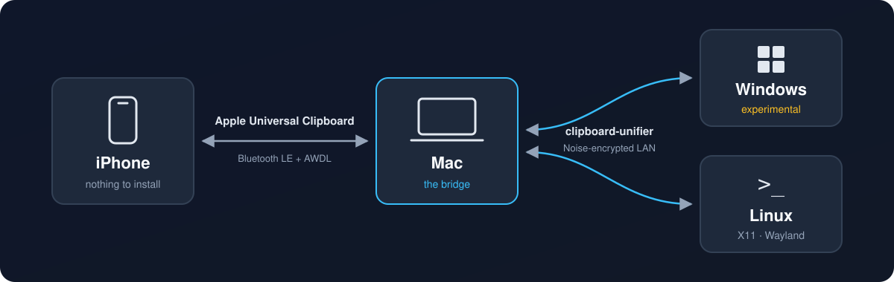
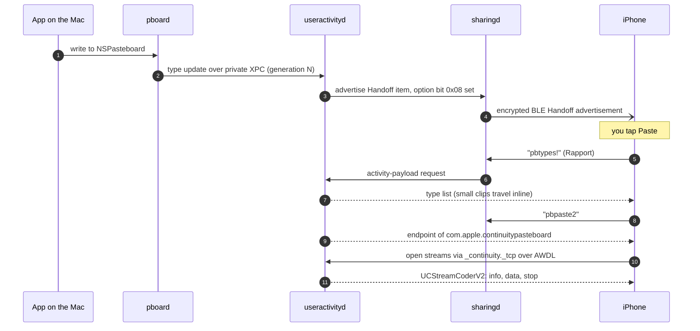

<div align="center">

# clipboard-unifier

### A short script that unifies your clipboard across iOS to Windows/Linux.

**Copy on your iPhone, paste on your PC, and back again. There's no iPhone app and no cloud: your Mac does the bridging.**

[](https://github.com/shdwfruit/clipboard-unifier/actions/workflows/ci.yml)
[](LICENSE)
[](https://www.rust-lang.org/tools/install)
[](#platform-support)
[](https://github.com/morluto/rea)

[How Universal Clipboard works](#how-universal-clipboard-works) · [Quick start](#quick-start) · [How the bridge works](#how-the-bridge-works) · [Platform support](#platform-support) · [FAQ](#faq) · [Documentation](#documentation)

<code>cargo install --git https://github.com/shdwfruit/clipboard-unifier</code>

<br /><br />



</div>

> [!NOTE]
> clipboard-unifier needs a **Mac** signed into the same Apple Account as your iPhone.
> Windows and Linux can't join Apple's Universal Clipboard directly
> ([here's why](#why-windows-and-linux-cant-join-directly)), so the Mac relays for them.

---

## How Universal Clipboard works

This was reverse engineered on macOS 26.6.2 (25G83) with
[REA](https://github.com/morluto/rea) (`inspect-macho`), `dyld_info`, `objdump`,
`codesign`, and the unified log. Live captures between a Mac and an iPhone then confirmed
the findings. Every claim in the [full write-up](docs/universal-clipboard-re.md) is labeled
*seen*, *inferred*, or *prior work*, and [`scripts/re-collect.sh`](scripts/re-collect.sh)
regenerates the raw evidence. This section is the short version.

### One copy, end to end



### The pieces

| Component | Role |
|---|---|
| `/usr/libexec/pboard` | The pasteboard server (CoreFoundation `CFPasteboard`). It forwards every local copy to `useractivityd` and receives "remote clipboard available" pushes back. |
| `useractivityd` | The Handoff daemon. Universal Clipboard is "UASharedPasteboard" inside it, behind the Mach services `com.apple.coreservices.uasharedpasteboard{manager,controll,aux}.xpc`. |
| `sharingd` | Bluetooth LE advertising and scanning, Handoff encryption keys, payload requests, and companion streams. |
| `rapportd` / `identityservicesd` | Device-to-device messaging between devices on the same Apple Account, locally (Rapport) or through the cloud (IDS). |

Only Apple-signed code can use the XPC path. `useractivityd` accepts it only from processes
holding `com.apple.private.coreservices.useractivityd.sharedpasteboard`, and `pboard` is the
only one that does. Third-party code has exactly one door: `NSPasteboard`.

### The Bluetooth advertisement

Disassembling `SharingBTLEAdvertisementPayload` gives the 9-byte plaintext:

```text
-[… payloadBytes]        → NSData(self+0x08, 7)
-[… containsPasteboard]  → ldrb w8, [x0, #0xf] ; ubfx w0, w8, #3, #1
-[… isCurrent]           → ldrb w8, [x0, #0x10] ; lsr  w0, w8, #7
-[… timeOffset]          → ldrb w8, [x0, #0x10] ; and  w0, w8, #0x7f
```

| Byte | Meaning |
|---|---|
| 0–6 | Hashed activity type (`_LSCreateHashedBytesForAdvertisingFromString`) |
| 7 | Option bits. **`0x08` = "my clipboard has content"** |
| 8 | Bit 7 = "is current", bits 0–6 = time offset |

`useractivityd` logs it as `ADVERTISING:$74609a719d90c6/*46 u pb-1 …`, which is the hash,
the current flag (`*`), the offset, and a **version bit** (`pb-0` / `pb-1`). The version bit
flips on every new copy, so receivers can tell a new clipboard from a re-broadcast.
Updates appear to be coalesced to at most one per second.

### Keys

Every device encrypts its advertisements with **its own Handoff key**, which carries a
use counter. A new key is generated when the counter hits its maximum. Other devices
request that key over **IDS or Rapport**
(`Requesting Encryption key via IDS from "%@"…`), and decryption checks an auth tag. So
membership in Universal Clipboard is enforced cryptographically: you must be a registered
device on the same Apple Account.

### Pasting

- **Types first.** The receiver sends the 8-byte command **`pbtypes!`** as a Handoff
  activity-payload request over Rapport. A 13-byte clip came back in a single 1,787-byte
  reply with no follow-up request, so small clips appear to travel inline.
- **Then data.** Larger clips use **`pbpaste2`** (v2; `pbpaste!` is v1). The reply is the
  endpoint of an `SFCompanionAdvertiser` for **`com.apple.continuitypasteboard`**.
- **The stream.** The receiver opens it via Bonjour **`_continuity._tcp`** on `awdl0`
  (Apple Wireless Direct Link). `UCStreamCoderV2` then exchanges tagged messages:
  `PasteboardInfoRequest/Response`, `PasteboardDataRequest/Response`,
  `PasteboardFileRequest/Response`, `Heartbeat`, and `Stop`.
- **The payload.** `Items[] → Types[] → {Type, UUID, Offset, Size, …}` plus one blob,
  so every representation travels at its own offset. Files appear to travel as archives.

### On the receiving Mac

An iPhone copy appears on the Mac's pasteboard **immediately**, before anything pastes it:

```text
19:25:50.787  [PBOARD] Notify client of new remote pboard and reset timmer
19:25:50.789  Created remote generation 11D686AC-…
19:25:50.789  [PBOARD CONTROLLER] Sending client xpc remote available update: YES
19:25:50.821  [REMOTE GEN] Received type info                     ← 32 ms
19:25:52.134  [PBOARD CONTROLLER] Requesting data from remote device
```

```text
types = [public.utf8-plain-text, NSStringPboardType, public.text, com.apple.is-remote-clipboard]
```

`com.apple.is-remote-clipboard` marks the item as coming from another device. CoreFoundation
uses it, and so does macOS 26's Spotlight clipboard history.

### Lifetime and policy

- **Content expires after 120 s.** For example, `Got type update` at 18:19:09.08 is followed
  by `Remove Local Types Fired` at 18:21:09.08.
- **Low Power Mode stops advertising** (` ** LowPowerMode is enabled so no activity will be
  advertised. ** `), but receiving keeps working.
- **Screen Sharing disables Universal Clipboard**
  (`Screen Sharing session in progress, Universal Clipboard is disabled`).

### Why Windows and Linux can't join directly

AirDrop *has* working open-source clients on Linux and Windows. AirDrop's "Everyone" mode
accepts senders who aren't on your Apple Account, so those projects only have to solve the
radio. Universal Clipboard has no such mode:

| Wall | Why |
|---|---|
| **Identity** | Handoff keys go only to IDS-registered devices on your Apple Account. Registration needs Apple-hardware validation data, the same wall Beeper Mini hit before Apple shut it down. |
| **Entitlements** | Even on a Mac, only Apple-signed processes can talk to `useractivityd`'s pasteboard service. |
| **Radio** | Bulk data moves over AWDL. Linux has [OWL](https://github.com/seemoo-lab/owl) on a few Wi-Fi chips; Windows has nothing. |

A Mac, though, is already a legitimate peer. clipboard-unifier uses it through
`NSPasteboard`, the one supported interface.

---

## Quick start

### Install

You need [Rust](https://www.rust-lang.org/tools/install) 1.88+. The build is pure Rust,
with no C dependencies. Install on the Mac and on each Windows or Linux machine:

```bash
cargo install --git https://github.com/shdwfruit/clipboard-unifier
```

### Pair your machines

On the Mac:

```bash
clipboard-unifier init       # prints a pairing code: cu1-xxxx-xxxx-…
```

On every other machine:

```bash
clipboard-unifier join cu1-xxxx-xxxx-…
```

### Run

On all of them:

```bash
clipboard-unifier run
```

Machines on the same network find each other over mDNS. If multicast is blocked (some
Wi-Fi, VPNs, WSL), connect them directly:

```bash
clipboard-unifier run --peer my-mac.local     # or an IP address; default port 47321
```

Copy something on the iPhone, then paste on the PC.

### Check the iPhone leg

The Mac and iPhone need the same Apple Account, Bluetooth and Wi-Fi on, and Handoff
enabled. On the Mac that's System Settings → General → AirDrop & Handoff; on the iPhone,
Settings → General → AirPlay & Continuity. Then run this and copy on the iPhone:

```bash
osascript -l JavaScript scripts/pbwatch.js
```

A line with `remote=true` means iPhone copies are reaching the Mac. `clipboard-unifier doctor`
reports the Handoff and paste-permission state.

To start automatically at login, see [docs/autostart.md](docs/autostart.md) (launchd,
systemd, Task Scheduler).

## How the bridge works

- **iPhone → PC:** an iPhone copy lands on the Mac's pasteboard, flagged
  `com.apple.is-remote-clipboard`. clipboard-unifier sees `changeCount` change, reads the
  clip (which starts the AWDL transfer), and sends it to every peer.
- **PC → iPhone:** clipboard-unifier writes the clip to the Mac's pasteboard as a normal
  local copy. macOS then advertises it to the iPhone like any other copy, and the iPhone
  can paste it for 120 s.
- **No feedback loops:** clips carry an id, are de-duplicated across the mesh, and echoes
  of our own writes are recognized and dropped.
- **Any topology:** clips are relayed between peers, so the mesh doesn't need to be fully
  connected.

| Command or flag | What it does |
|---|---|
| `clipboard-unifier doctor` | Checks the config, clipboard access, and (on macOS) Handoff and paste permission |
| `clipboard-unifier code` | Prints the pairing code again |
| `run --local-only` | macOS: keeps clips from other machines on the Mac instead of offering them to the iPhone (`NSPasteboardContentsCurrentHostOnly`) |
| `run --peer HOST[:PORT]` | Adds a static peer (repeatable) |
| `run --no-discovery` | Uses only `--peer` connections |
| `run --max-mb N` | Sets the largest clip to send or accept (default 32 MiB) |
| `RUST_LOG=debug` | Enables verbose logs, which still never include clipboard contents |

## Platform support

| Platform | Status | Notes |
|---|---|---|
| **macOS** | ✅ Supported | The bridge. Tested on macOS 26.6.2: iPhone copies reaching the Mac, Mac → iPhone, and Mac ↔ Linux end to end. |
| **Linux (X11)** | ✅ Supported | Tested end to end against a real Mac (text and images, both directions). |
| **Linux (Wayland)** | 🟡 Untested | Needs the data-control protocol (KDE, Sway, Hyprland). GNOME uses the XWayland clipboard. |
| **Windows** | 🧪 **Experimental** | Builds and passes CI, but hasn't been run on real hardware yet. Reports welcome. |

## Security

- **The pairing code *is* the key.** Anyone who has it can read and write your clipboard,
  so treat it like a password. On Unix the config file is created with mode `0600`.
- **Encryption.** Every connection runs a Noise `NNpsk0_25519_ChaChaPoly_BLAKE2s`
  handshake, with HKDF-SHA256 of the pairing secret as the pre-shared key. Without the code,
  a machine can't complete the handshake. Each connection uses fresh ephemeral keys, which
  gives forward secrecy.
- **No cloud.** Traffic stays on your network, and there is no server.
- **Password managers.** Content they mark as private is never sent. On macOS that's
  `org.nspasteboard.ConcealedType` or `TransientType`. On Windows it's
  `ExcludeClipboardContentFromMonitorProcessing`, `Clipboard Viewer Ignore`, or
  `CanIncludeInClipboardHistory = 0`.
- **Logs** record the kind and size of each clip (`text 42B`), never its contents.

Report vulnerabilities as described in [SECURITY.md](SECURITY.md).

## Limitations

- **A Mac is required** for the iPhone leg (see [above](#why-windows-and-linux-cant-join-directly)).
- **There's a two-minute window to paste on the iPhone.** That's Apple's 120 s Universal
  Clipboard expiry.
- **iPhone clips are fetched as soon as they're copied**, not when you paste, so they can
  be forwarded.
- **Only text and images are synced.** Files, rich text, and multiple items aren't. Images
  travel as PNG.
- **The last copy wins.** There's no history.
- **On Linux, KDE's password-manager hint isn't detected yet.** Linux images are polled about
  every 1.5 s, and only when there's no text.
- **IPv4 only.** Your firewall may ask whether clipboard-unifier can accept incoming
  connections.

## FAQ

<details>
<summary><strong>Do I need to install anything on the iPhone?</strong></summary>

No. The iPhone talks only to the Mac, using Apple's own Universal Clipboard. Unlike
clipboard-sync apps, nothing runs on the iPhone. iOS doesn't let apps read the clipboard in
the background, which is why those apps need a manual Share step.

</details>

<details>
<summary><strong>Does it work without a Mac?</strong></summary>

Not the iPhone part. Windows ↔ Linux sync works without one, but for that you have
plenty of other tools. Universal Clipboard requires a device registered to your Apple
Account; see [Why Windows and Linux can't join directly](#why-windows-and-linux-cant-join-directly).

</details>

<details>
<summary><strong>macOS asks whether clipboard-unifier may paste from other apps.</strong></summary>

macOS 26 asks before an app reads the clipboard programmatically. Allow clipboard-unifier in
System Settings → Privacy & Security → Paste from Other Apps. `clipboard-unifier doctor`
shows the current setting.

</details>

<details>
<summary><strong>Mac → iPhone works, but iPhone → Mac doesn't.</strong></summary>

Run `osascript -l JavaScript scripts/pbwatch.js` and copy on the iPhone. If no
`remote=true` line appears, check whether the iPhone is announcing its copies at all:

```bash
log show --last 10m --style compact --predicate \
  'process == "useractivityd" AND eventMessage CONTAINS "RECEIVED advertisement"'
```

If no line shows `CopyPasteKey = 1` after an iPhone copy, the iPhone isn't advertising
it. In our case, turning Handoff off and on didn't help, but **restarting the iPhone**
did. More in the [troubleshooting notes](docs/universal-clipboard-re.md#9-troubleshooting-one-direction-dead).

</details>

<details>
<summary><strong>Does any clipboard data go through Apple or a server?</strong></summary>

Between the iPhone and the Mac, Universal Clipboard works the way Apple designed it:
Bluetooth LE plus peer-to-peer Wi-Fi, using keys from your Apple Account. Between
your computers, clipboard-unifier sends data directly over your local network with no
server in between.

</details>

## Documentation

- [Universal Clipboard, reverse engineered](docs/universal-clipboard-re.md): the full
  write-up, with evidence labels and disassembly
- [Design](docs/design.md): goals, non-goals, and architecture
- [Start at login](docs/autostart.md): launchd, systemd, and Task Scheduler
- [Contributing](CONTRIBUTING.md): development setup, tests, and the end-to-end harness
- [`scripts/pbwatch.js`](scripts/pbwatch.js): a passive macOS pasteboard watcher that
  shows types only, never contents
- [`scripts/re-collect.sh`](scripts/re-collect.sh): regenerates the reverse-engineering
  evidence (read-only)

## Disclaimer

clipboard-unifier is an independent project. It isn't affiliated with, endorsed by, or
sponsored by Apple Inc. Apple, iPhone, Mac, macOS, Handoff, and Universal Clipboard are
trademarks of Apple Inc.

The reverse engineering was done on hardware we own, for interoperability. The project
contains no Apple code. It uses only public macOS APIs (`NSPasteboard`) and doesn't bypass
any security mechanism.

## Acknowledgements

- [REA](https://github.com/morluto/rea), which kicked off this investigation.
- Prior research on Apple Continuity:
  - Martin et al., [*Handoff All Your Privacy*](https://petsymposium.org/popets/2019/popets-2019-0057.php) (PoPETs 2019)
  - Stute et al., [*Disrupting Continuity of Apple's Wireless Ecosystem Security*](https://www.usenix.org/conference/usenixsecurity21/presentation/stute) (USENIX Security 2021)
  - Sam Teplov's [Continuity BLE dissector work](https://samteplov.com/projects/apple-ble-rev/)
  - SEEMOO's [OWL](https://github.com/seemoo-lab/owl) and [OpenDrop](https://github.com/seemoo-lab/opendrop)

## Contributing

Windows testers are especially welcome. [Open an issue](https://github.com/shdwfruit/clipboard-unifier/issues)
with the output of `clipboard-unifier doctor` and `RUST_LOG=debug clipboard-unifier run`.
See [CONTRIBUTING.md](CONTRIBUTING.md) for development setup.

## License

[MIT](LICENSE)
